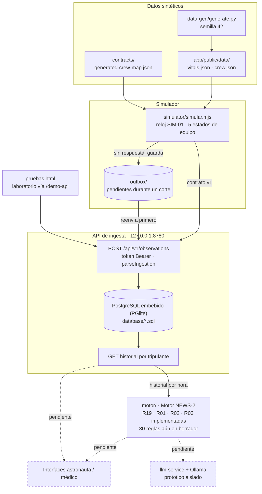

# KAWSAY

Simulador recuperado: ejecutar `Simulador-KAWSAY.cmd` o consultar
[fuentes, comandos y límites](docs/SIMULADOR_RECUPERADO.md).
Incluye ocho vistas y almacenamiento local; el envío desde este simulador a la API SQL sigue pendiente.

## Panel actual — 14 de noviembre de 2026

API y persistencia: el contrato de ingesta ya tiene un receptor transaccional
para PostgreSQL, con datos ficticios y pruebas de SQL embebidas.
Ver [inicio de la API](docs/API_RECEPCION.md) y
[checklist de implementación](docs/CHECKLIST_IMPLEMENTACION.md).
La conexión a un servidor PostgreSQL externo y su prueba de concurrencia siguen pendientes.

La entrada principal ahora ofrece las vistas Astronauta y Personal médico,
adaptación a pantallas pequeñas, autorreporte vinculado por tripulante,
exportación de telemetría y catálogo médico en borrador.
La compilación incluye manifest y caché de recursos estáticos para la PWA.
Consulta [estado y límites de integración](docs/AVANCE_INTERFACES.md).
Las instrucciones históricas del aporte de datos siguen a continuación.

Team KUNTUR X · Synthetic crew data and local check-in contribution.

This branch recovers the data generator and local recording prototype from the
November 13 practice session. It provides reproducible mission datasets, a React
data preview, and a reusable check-in with confirmation, local history and JSON
export. No real astronaut or patient data are included.

## Arquitectura (estado al 15/11/2026)



Línea continua: implementado y probado el 15/11 en una laptop. Línea punteada: pendiente.

## Motor NEWS-2 (borrador)

`motor/` lee el historial de un tripulante desde la API, agrupa las observaciones por hora
y calcula NEWS-2 con `news2()` de `data-kit/simulator/mission.mjs`. Reglas implementadas:
R19 (datos insuficientes), R01 (total ≥ 7, EMERGENCY), R02 (total ≥ 5, PRIORITY) y
R03 (algún parámetro con 3 puntos, PRIORITY). Un total de 0–4 queda sin nivel hasta la
decisión clínica del equipo. Resultado en borrador: no está validado clínicamente.

Con la API en marcha (`npm run api:embedded` desde `data-kit/`), desde la raíz del repositorio:

```bash
node --env-file=data-kit/.env motor/demo.mjs GEN-MEMBER-A 80
node --test motor/desde-contrato.test.mjs motor/evaluar.test.mjs motor/historial.test.mjs
```

## Branch workflow
- Current delivery branch: `feat/contrato-api-sql`.
- Proposed PR target for this delivery: `main`, pending team review. Do not merge automatically.
- The commands below document the earlier generator workflow; they do not publish this delivery.
- On Windows use a local branch without `|`, such as `datos-generador`:

```powershell
git clone --single-branch --branch main https://github.com/alexandersoliscama-coder/KAWSAY.git
cd KAWSAY
git fetch origin "refs/heads/Datos-|-GENERADOR"
git switch -c datos-generador FETCH_HEAD
```

The clone reads the initial history; work then uses the local data branch.

When your GitHub credentials have write access, publish the committed work with
`powershell -File scripts/Publicar-Datos.ps1`. It verifies the repository and
local branch, checks for uncommitted changes and refuses to overwrite a diverged
remote branch. It pushes only `HEAD:refs/heads/Datos-|-GENERADOR`, never main.

## Quick start

Requires Python 3.10+ and Node.js 24.13+ with npm. The generator uses the Python
standard library and needs no pip packages. From the repository root:

```powershell
python data-gen/generate.py
python data-gen/generate.py --check
python -m unittest discover -s data-gen -v
cd data-kit
npm ci
npm test
npm run typecheck
npm run build
npm run preview
```

Open **http://127.0.0.1:4173**. Stop with Ctrl+C. **Datos de misión** loads the
generated files and reproduces the scripted stories. **Mi revisión** records
synthetic observations after confirmation. Reload using the same browser and
origin to recover history.

Windows helper: `powershell -File scripts/Preparar-Datos.ps1` from the repository
root generates/verifies data, installs locked dependencies, tests, type-checks
and builds the preview. It does not start a background server or change branches.
Run `npm run preview --prefix data-kit` afterwards.

## Contents

| Path | Purpose |
| --- | --- |
| `data-gen/` | Seeded Python generator and tests |
| `app/public/data/` | Four datasets and reproducibility manifest |
| `data-kit/src/checkin/` | Typed answers, validation and persistence |
| `data-kit/src/ui/CheckIn.tsx` | Reusable recording form |
| `data-kit/src/mission.ts` | Validation, loading and time/module joins |
| `data-kit/src/adapters.ts` | Explicit mapping without clinical decisions |
| `data-kit/demo/` | Isolated integration preview, not the final team UI |
| `docs/DATA_CONTRACT.md` | Units, clocks and integration boundaries |
| `docs/IMPLEMENTACION_Y_APORTE.md` | Recovery, changes and remaining work |
| `.github/workflows/data-checks.yml` | Automated checks |

## Dataset

Default seed: **42**. Every row has `synthetic: true`.

| File | Rows | Observation |
| --- | ---: | --- |
| `crew.json` | 4 | Person |
| `vitals.json` | 2,880 | Person/hour |
| `daily.json` | 120 | Person/day |
| `environment.json` | 1,440 | Module/hour |
| `manifest.json` | Metadata | Seed, units, resolutions, ID crosswalk and SHA-256 hashes |

```powershell
python data-gen/generate.py --seed 43 --out alternate-data
python data-gen/generate.py --seed 43 --out alternate-data --check
```

The series include Ana's changing vitals, Ben's short sleep and test results,
Carla's environmental exposure/headache, and Diego's changed measurements despite
feeling fine. Read the contract before combining daily and hourly records.

## Local Ollama prototype

The isolated preview now includes a **Monitor IA** tab backed by
`python llm-service/service.py`. It requests reports every five minutes, persists
synthetic snapshots and reports in SQLite, and publishes nonclinical demo notices
before inference. See [Ollama setup and limits](docs/OLLAMA.md). Manual check-ins
remain separate; no real-time sensors or clinical triage have been implemented.

## Original data contribution boundaries

This module does not implement NEWS2, clinical rules, triage or EVA clearance.
Nested field names are a proposed contract for the motor branch to review.
The manual check-in lacks some inputs needed for a complete NEWS2 assessment.
Missing answers remain unknown. Daily symptoms have no invented hourly onset.

The recovered persistence uses localStorage behind an injectable adapter, not
IndexedDB. It targets synthetic data and one browser tab. Corrupt history and
duplicate saves are rejected; storage errors remain visible for retry. There is
no authentication, application encryption, multi-writer coordination, remote
sync or service worker. Exporting is not sending to Earth. The clinical engine,
final PWA and Earth Packet remain team integration work.

## Attribution

Data and recording contribution: Liu Bryan Cayllahua Huaringa. Profiles and
events derive from the team's KUNTUR X work guide. Values are invented, not NASA
physiological reference data. Codex assistance is recorded in `docs/AI_USAGE.md`.
