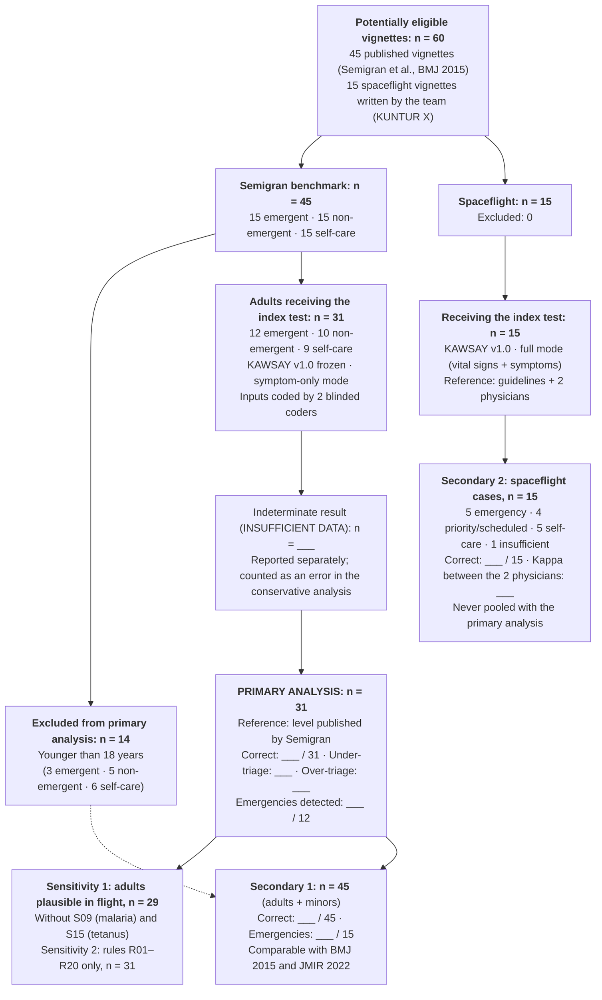
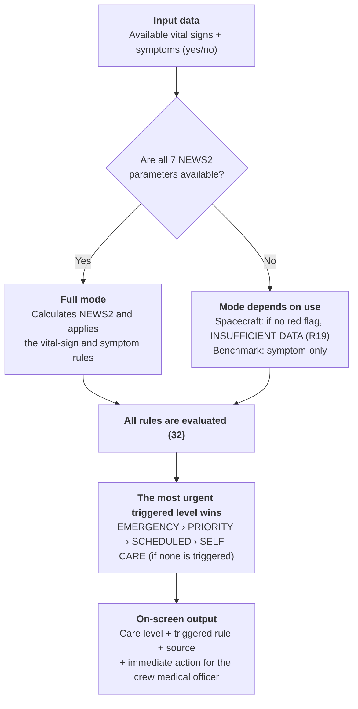
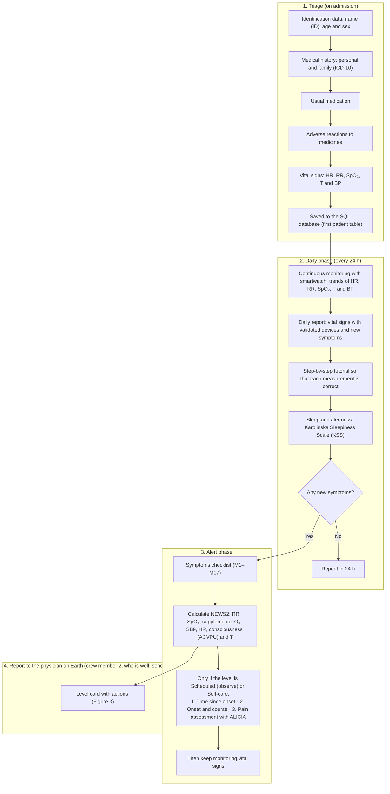

# KAWSAY — Evaluation protocol, implementation status and scalability

> **What this document is.** A single reference that brings together three things:
>
> - **Part I** — the evaluation protocol written by the team (converted to Markdown from `KAWSAY_Evaluation_Protocol_EN (7).docx`). The protocol text is kept as the team wrote it; figures are redrawn as diagrams and tables.
> - **Part II** — what the protocol still needs, contrasted with what is implemented in this repository on 15 November 2026.
> - **Part III** — the four priorities closed on 15 November 2026 (AI-use declaration, official engine, real stack, knowledge graph) and the scalability path (V3).
>
> **Status:** protocol draft, not yet frozen. No official run has been recorded in this repository (no `v1.0-eval` tag, Appendices D and E empty). All rules remain drafts pending physician sign-off.

## Contents

- [Part I — Evaluation protocol](#part-i--evaluation-protocol)
  - [Abstract](#abstract) · [1. Introduction](#1-introduction) · [2. Rationale](#2-rationale) · [3. Objectives and hypotheses](#3-objectives-and-hypotheses) · [4. Methods](#4-methods) · [5. Limitations](#5-limitations) · [6. Timeline and responsibilities](#6-timeline-and-responsibilities) · [References](#references) · [Appendices A–F](#appendix-a-stard-2015-checklist)
- [Part II — Implementation status against the protocol](#part-ii--implementation-status-against-the-protocol)
- [Part III — Priorities closed on 15 November 2026 and scalability](#part-iii--priorities-closed-on-15-november-2026-and-scalability)

---

# Part I — Evaluation protocol

## Triage accuracy of KAWSAY, an Earth-independent clinical decision support system: protocol for a clinical vignette study

### Abstract

**Introduction.** On a mission to Mars the crew will have no real-time medical support and will have to judge the severity of every health problem on their own. Symptom checkers available on Earth choose the right level of care in little more than half of cases.

**Objective.** To estimate the triage accuracy of KAWSAY v1.0, an offline engine of explainable rules, and its sensitivity for detecting emergencies.

**Methods.** Diagnostic accuracy study using clinical vignettes, planned and registered before the index test is applied and reported according to STARD 2015. We will use the 45 vignettes published by Semigran and colleagues in the BMJ (2015); the primary analysis includes the 31 vignettes describing adult patients. As a secondary analysis, 15 vignettes based on medical problems documented in flight will be evaluated. The reference standard is the triage level published by the benchmark authors. Two independent, blinded coders will convert the text of each vignette into input data. The primary outcome is the proportion of correct triage with its 95% confidence interval. Secondary outcomes are sensitivity for emergencies, under-triage, over-triage and agreement between coders. Results will be compared descriptively with the 57% correct triage reported for the symptom checkers that gave triage advice.

## 1. Introduction

Human exploration beyond low Earth orbit changes the way crew health is managed. On the International Space Station, astronauts can speak to a physician on Earth at any time and, if necessary, return within hours. None of this will be possible on a mission to Mars. Communication with Earth will take up to 22 minutes each way and there will be no evacuation, which is why NASA is planning Earth-independent medical operations [1]. The problem is not small: NASA's Integrated Medical Model estimates about 166 medical events during a 16-month transit with four crew members [2]. Each of those events will force the crew to answer a simple but decisive question first: how serious is it, and what needs to be done now?

That question already matters on current missions. On 15 January 2026, the Crew-11 crew returned to Earth a month earlier than planned, in the first medical evacuation in the history of the International Space Station [3]. Health problems in flight are also common: a study of long-duration missions on the station found that rashes, congestion and infections occur regularly [4]. These cases are handled on board by the crew medical officer, who is often not a physician and receives about 25 hours of training, with permanent support from physicians on Earth [5]. In low Earth orbit that support exists; on Mars the crew medical officer will have to decide alone.

The first mission where this matters in practice is Artemis IV, planned for early 2028: the first crewed lunar landing since 1972, with two astronauts spending about a week near the lunar South Pole while the other two remain in lunar orbit [6]. Communication with Earth from the Moon takes only a little over a second each way, but bringing an ill crew member home takes days, so the decision about how serious a problem is has to be made on site. KAWSAY therefore takes Artemis IV as its first reference mission and long-duration missions to Mars as its final goal. Several of the spaceflight cases, such as the neuro-ocular syndrome or congestion lasting more than ten days, describe problems that develop over weeks or months, which reflects that broader scope.

The tools that currently assign severity from symptoms were not designed for this situation. Semigran and colleagues evaluated 23 symptom checkers with 45 standardised clinical vignettes; the 15 that gave triage advice chose the right level of care in 57% of evaluations and in 80% of emergencies [7]. Five years later, using the same vignettes, the median accuracy was 55.8% [8]. These tools assume that the patient can reach an emergency department within minutes and, in most cases, do not disclose the logic behind their decisions. NASA and Google are developing an artificial intelligence medical assistant for deep-space missions, but its evaluation results are not yet public [9].

## 2. Rationale

A triage tool is needed that works offline, explains every decision and has had its accuracy measured transparently. On a spacecraft with no possibility of evacuation, the most serious error is failing to recognise an emergency, because it cannot be corrected later. A closed tool does not reveal when or why it fails, which prevents a crew medical officer from trusting it. We therefore propose rules drawn from international clinical guidelines and NASA standards that any physician can review.

The evaluation must also follow a recognised method. Painter and colleagues reviewed studies of symptom checkers, found widely differing methods and proposed a vignette-based standard that requires, among other points, stating the origin of the cases, defining the reference standard and reporting under-triage and over-triage separately [10]. The STARD 2015 guideline further requires eligibility criteria to be set in advance, the flow of cases to be shown and the handling of indeterminate results to be explained [11]. Using the same 45 public vignettes as the 2015 and 2022 studies also allows the result to be compared with published data.

The study is feasible with open resources. The vignettes are freely available for non-commercial use, the engine runs in a web browser and the evaluation involves no human participants. If KAWSAY matches or exceeds the accuracy of commercial symptom checkers using open rules, it will have grounds to be used as decision support on deep-space missions. The same offline, auditable design could also serve rural and Amazonian areas of Peru, where access to a physician is limited and connectivity is unreliable.

## 3. Objectives and hypotheses

The primary objective is to estimate the proportion of correct triage by KAWSAY v1.0 in the 31 adult vignettes of the Semigran benchmark, with its 95% confidence interval.

There are six secondary objectives: to estimate sensitivity for emergencies; to describe the frequency of under-triage and over-triage; to estimate accuracy in all 45 vignettes, including minors, for comparison with published studies; to estimate accuracy in the 15 spaceflight vignettes; to measure agreement between the coders who convert the text into input data and between the two physicians who endorse the level of the spaceflight cases; and to count indeterminate results and serious errors, defined as an emergency classified as self-care.

Two exploratory hypotheses were set before the test is applied. The first is that the accuracy of KAWSAY exceeds the 57% published for symptom checkers [7]. The second is that its sensitivity for emergencies is at least 80%. As a safety criterion, no emergency is expected to be classified as self-care. With 31 cases the study is not powered to confirm small differences, so interpretation rests mainly on the confidence intervals.

## 4. Methods

### 4.1 Design and reporting guidelines

This is a diagnostic accuracy study using clinical vignettes, carried out in silico with no human participants. It was planned before the index test is applied: the protocol, the rules and the input data will be frozen and registered before a single official run. The study will take place during the in-person phase of the NASA Space Apps Challenge 2026 in Peru, from 13 to 15 November 2026.

Reporting follows the STARD 2015 guideline for diagnostic accuracy studies [11]; the full checklist is in Appendix A. For aspects specific to vignettes, the recommendations of Painter and colleagues are followed [10]. From the DECIDE-AI guideline [12] only the transparency items on system version and functioning are used; it is not applied in full because KAWSAY does not use artificial intelligence to make decisions and this stage does not involve real users.

All sources that support the project, classified by category and by type and quality of evidence, and linked to the rules and sections they support, are listed in the companion spreadsheet `KAWSAY_References.xlsx` (77 sources). Every clinical rule rests on at least one guideline, systematic review or study in a top-quartile journal; press articles are used only for context.

### 4.2 Case sources and eligibility criteria

Sixty vignettes were considered. Forty-five come from the supplement of the study by Semigran and colleagues [7, 13], which contains 15 emergent, 15 non-emergent and 15 self-care cases, each with age, sex, symptoms, diagnosis and correct triage level. The supplement also includes a simplified version of the symptoms, which the authors entered into each symptom checker. The remaining 15 vignettes were written by the team, with the help of an artificial intelligence assistant, based on medical problems documented in flight or on NASA standards; they are fictional and their vital signs were constructed to be consistent with each presentation.

The primary analysis includes the benchmark vignettes describing patients aged 18 years or older. The 14 cases involving minors are excluded because KAWSAY is designed for adult astronauts and because NEWS2, on which many of the rules rely, was validated in adults [14]. No case is excluded because of its diagnosis, its difficulty or the answer the application gives. Minors are included in the first secondary analysis, which uses all 45 vignettes, and the spaceflight vignettes form the second secondary analysis.

Three sensitivity analyses were defined in advance. The first excludes two cases that require an exposure impossible in a closed spacecraft: malaria (S09), which requires the bite of an infected mosquito after travel to an endemic area, and tetanus (S15), which requires a wound contaminated with soil spores. The second repeats the primary analysis using only rules R01 to R20, written before the team knew the topics of the benchmark. The third runs the engine with each coder's data separately, to measure how much the result depends on who enters the data [10]. The full flow of cases is shown in Figure 1 and the case-by-case detail in Appendix C.

**Figure 1. Flow of vignettes according to STARD 2015.** Blank values (`___`) will be completed after the official run.

### 4.3 Index test

The index test is KAWSAY v1.0, an engine of 32 active rules that does not use artificial intelligence. It receives the available vital signs and a list of symptoms, and returns a level of care (EMERGENCY, PRIORITY, SCHEDULED, SELF-CARE or INSUFFICIENT DATA), the rule that triggered it and an immediate action for the crew medical officer. Rules R01 to R04 are based on the NEWS2 score and on the change from each crew member's baseline [14, 15]. Rules R05 to R12b recognise red flags such as chest pain, shortness of breath, neurological deficit, headache with red flags, syncope, sepsis and sudden loss of vision [16, 17, 18, 19]. Rules R13 to R15 cover mild problems that are common in flight; R17 assesses fitness for duty (sleep and sleepiness); R19 and R20 check data quality; and R21 to R31 cover general presentations based on guidelines from the IDSA, the American Society of Hematology, the WSES, the World Allergy Organization and the AAO-HNS [20, 21, 22, 23, 24, 25, 26, 27]. Two rules are kept in the rule set for future evaluation but are not active in version 1.0: R16, based on a 3-minute reaction test, because it could not yet be implemented reliably in the browser, and R18, based on the cabin carbon dioxide level, because that measurement depends on the spacecraft's life-support system and is outside the prototype. Neither is used in any of the 60 vignettes. Each rule, with its source and limitations, is described in the medical rationale document and in the project spreadsheet.

The engine evaluates all rules and assigns the most urgent level triggered (Figure 2). When all seven NEWS2 parameters are available, it runs in full mode. When any is missing, its behaviour depends on the setting. On the spacecraft, if no red-flag rule is triggered, it returns INSUFFICIENT DATA and asks for new measurements. For the benchmark vignettes, which almost never include vital signs, it runs in symptom-only mode: it does not calculate NEWS2, disables R19 and uses only the signs that a rule names individually, such as a respiratory rate of 25 or more or an oxygen saturation of 91% or less (R06) and a temperature of 38.0 °C or more (R27). If no rule is triggered, the level assigned is SELF-CARE.

**Figure 2. How the KAWSAY engine decides.**

### 4.4 How the five levels were built

The KAWSAY levels were built in five steps. The first adopted the structure of NEWS2, in which each of the seven parameters receives 0 to 3 points according to how far it departs from normal; the points are added and the total sets the urgency of the response and the minimum monitoring frequency [14] (Tables 1 and 2). A total of 7 or more requires an emergency response and continuous monitoring, and corresponds to EMERGENCY in KAWSAY. A total of 5 or 6, or a single parameter scoring 3, requires an urgent response and hourly monitoring, and corresponds to PRIORITY. NICE uses the same cut-offs to classify sepsis risk and sets reassessment times of 30 minutes, 1 hour and 4 to 6 hours according to risk [15].

The second step divided the NEWS2 low-risk band (0 to 4 points) into two levels: SCHEDULED, for symptoms the crew medical officer should review within 24 hours even if they are not urgent, and SELF-CARE, for problems managed with the medical kit. This division and the 24-hour window are our own design choice, because on a spacecraft there is no option of visiting a general practitioner. The third step translated the urgency indicated by each clinical guideline into one of these levels: guidelines calling for an emergency response or immediate treatment (chest pain, stroke, anaphylaxis, probable sepsis) were assigned to EMERGENCY; those calling for confirmation with a test or treatment within hours (thrombosis, possible sepsis, cellulitis) to PRIORITY; those calling for non-urgent assessment and treatment (cystitis, pharyngitis, positional vertigo) to SCHEDULED; and those indicating symptomatic management to SELF-CARE. The fourth step added the INSUFFICIENT DATA level, because NEWS2 is valid only with all seven parameters. The fifth set the combination rule: the engine evaluates all rules at once and assigns the most urgent level triggered.

The result is a five-level scale, like the most widely used emergency triage scales; the American College of Emergency Physicians and the Emergency Nurses Association support the use of a validated triage scale of this type, such as the Emergency Severity Index [28]. Unlike those scales, and unlike the three benchmark categories, which indicate where to seek care, KAWSAY levels indicate how soon to act, because on a spacecraft there is no service to refer to. The scale as a whole has not been validated: its accuracy is precisely what this study measures. The NEWS2 points and responses were defined by consensus of an expert group of the Royal College of Physicians; what has been validated in large studies is the ability of the score to predict deterioration [29].

**Table 1. NEWS2 points by parameter (SpO₂ scale 1) [14].**

| Parameter | 3 | 2 | 1 | 0 | 1 | 2 | 3 |
|---|---|---|---|---|---|---|---|
| Respiratory rate (per min) | ≤ 8 | | 9–11 | 12–20 | | 21–24 | ≥ 25 |
| SpO₂ (%) | ≤ 91 | 92–93 | 94–95 | ≥ 96 | | | |
| Supplemental oxygen | | Yes | | No | | | |
| Systolic BP (mmHg) | ≤ 90 | 91–100 | 101–110 | 111–219 | | | ≥ 220 |
| Pulse (per min) | ≤ 40 | | 41–50 | 51–90 | 91–110 | 111–130 | ≥ 131 |
| Consciousness | | | | Alert | | | C, V, P or U |
| Temperature (°C) | ≤ 35.0 | | 35.1–36.0 | 36.1–38.0 | 38.1–39.0 | ≥ 39.1 | |

**Table 2. NEWS2 response and equivalent KAWSAY level.**

| NEWS2 score | Risk | Minimum monitoring | Response | KAWSAY level |
|---|---|---|---|---|
| ≥ 7 | High | Continuous | Emergency | EMERGENCY |
| 5–6 | Medium | Hourly | Urgent | PRIORITY |
| 3 in one parameter | Low–medium | Hourly | Urgent | PRIORITY |
| 1–4 | Low | Every 4–6 h | Assessment | SCHEDULED or SELF-CARE, depending on symptom rules |
| 0 | Low | Every 12 h | Routine | SELF-CARE if no red flag |
| Missing parameters | — | — | — | INSUFFICIENT DATA, if no red flag |

After assigning a level, KAWSAY shows the crew what to do now, how often to recheck, when to contact Earth and when to escalate (Figure 3). Recheck intervals follow the NEWS2 clinical response chart: at least every 12 hours for a score of 0, every 4 to 6 hours for 1 to 4, every hour for 5 or 6 or a single parameter scoring 3, and continuous monitoring for 7 or more [30], with the score recalculated every 30 minutes at high risk [15]. Emergency actions follow first-response guidelines: a lay rescuer checks responsiveness and normal breathing, without a pulse check, before starting cardiopulmonary resuscitation [31]; oxygen is given to a target saturation of 94% to 98% [32]; and the time of symptom onset is recorded because it determines stroke treatment [17]. Before acting on an abnormal value the reading is repeated, because poor perfusion, cold skin and nail polish reduce pulse oximeter accuracy [33], and blood pressure is measured seated, after rest, with the arm at heart level [34]. Non-urgent problems are raised at the private medical conferences that the crew holds regularly with flight surgeons [35]. Three elements are our own adaptation to spaceflight and are reported as such: review within 1 hour at PRIORITY, review within 24 hours at SCHEDULED, and escalation from SELF-CARE when symptoms do not improve within 48 hours. To keep the screens readable they show no references; every source is listed in the rules catalogue and in the reference spreadsheet.

**Figure 3. What the crew sees for each level: actions, recheck interval, contact with Earth and escalation.**

| Level | Do now | Recheck | Earth | Escalate |
|---|---|---|---|---|
| 🟥 **EMERGENCY** — *Act now* | Check response and normal breathing; if absent, start CPR · If SpO₂ is under 94%, give oxygen (target 94–98%) · Note the time symptoms began · Follow the steps for this alert · Stay with the crew member | Continuous; recalculate every 30 min | Send data at the first link | — |
| 🟧 **PRIORITY** — *Review within 1 hour* | Repeat the abnormal reading · Medical officer reviews within 1 hour · Look for a cause: infection, pain, dehydration | Every hour | Consult at the next communication window | To Emergency if NEWS2 reaches 7 |
| 🟦 **SCHEDULED** — *Review within 24 hours* | Log symptoms daily in the app · Medical officer reviews within 24 hours | Every 4–6 hours | Raise at the next private medical conference | To Priority if NEWS2 reaches 5 |
| 🟩 **SELF-CARE** — *Manage on board* | Use the kit item for this alert · Rest, hydrate and log in the daily report | At least every 12 hours | — | If a warning sign appears, NEWS2 reaches 5 or no better in 48 hours |
| ⬜ **INSUFFICIENT DATA** — *Measure again* | Oximeter: warm finger, no nail polish, stable reading · Breathing: count a full 60 seconds · Blood pressure: seated, arm at heart level, 3–5 min rest | — | — | Rule: no level without complete data |

### 4.5 Assessment of level of consciousness

NEWS2 assesses consciousness with the ACVPU scale: alert, new confusion, responds to voice, responds to pain or unresponsive; any category other than alert scores 3 points [14]. To make the assessment reproducible, the crew medical officer always follows the same order: observes without speaking, then speaks to the crew member and, if there is no response, applies a central painful stimulus. Because NEWS2 does not define how to identify new confusion, KAWSAY uses the 4AT, a test of about two minutes that assesses alertness, orientation, attention (months of the year backwards) and acute change; a score of 4 or more is recorded as new confusion. In a meta-analysis of 17 studies the 4AT showed a sensitivity and specificity of 88% for delirium [36], although it was validated mainly in older hospitalised adults. The scale cannot be applied to the benchmark vignettes, so consciousness only plays a role when the text describes confusion.

### 4.6 Reference standard

For the benchmark vignettes, the reference standard is the triage level published by the authors of the original study [7]. It was chosen because it is public, it was used by two studies in high-impact journals and it allows direct comparison with 23 commercial symptom checkers. Because the benchmark uses three categories and KAWSAY uses four, triage is judged as a range, as recommended by Painter [10]. An emergent case is considered correctly classified only if KAWSAY returns EMERGENCY. A non-emergent case is considered correctly classified if the answer is PRIORITY or SCHEDULED. A self-care case is considered correctly classified if the answer is SELF-CARE. This mapping was fixed before running the test and will not be changed.

For the spaceflight vignettes, the reference level was proposed case by case from a clinical guideline or a NASA standard, with the help of an artificial intelligence assistant. Claudia Pinto and Milagros Villegas will review it separately, without communicating with each other and without seeing the application's answer, and will either endorse it or propose another level. Linear weighted kappa between them will be calculated. Disagreements will be resolved by consensus; if consensus is not reached, the more urgent level will be adopted. Because the same team wrote the rules, the cases and the proposed reference, the application is expected to agree with it; for this reason, this analysis is never pooled with the primary analysis.

### 4.7 Conversion of vignettes into input data

The vignettes are text and the engine takes data, so this step can introduce errors or unintentionally favour the application. To prevent this, Yeremi Camacho will prepare a file containing only the identifier and the text of each vignette, in random order and without diagnosis, reference level or application output. Liu Bryan Cayllahua and Rodrigo Coronel will independently code each symptom as present or absent, following a data dictionary that defines each variable in plain language (Appendix B). A symptom is coded as present only if the text mentions it. Vital signs are copied only when they appear in the text, and temperatures in degrees Fahrenheit are converted to Celsius with one decimal place; no missing data are imputed.

Agreement between coders will be measured with Cohen's kappa for each variable and with overall percentage agreement. Claudia Pinto will resolve disagreements by reading only the vignette text and the dictionary, and each decision will be recorded. The final file will be frozen together with the rules before the run.

### 4.8 Outcomes

The primary outcome is correct triage, meaning that the level assigned by KAWSAY falls within the range corresponding to the reference level. Sensitivity for emergencies is the proportion of emergent cases that KAWSAY classifies as EMERGENCY, and specificity for emergencies is the proportion of non-emergent or self-care cases that it does not classify as such. Under-triage occurs when KAWSAY assigns a less urgent level than the reference, and over-triage when it assigns a more urgent one. Any emergency classified as SELF-CARE is considered a serious safety error. An indeterminate result is an INSUFFICIENT DATA answer in a case whose reference level is different.

### 4.9 Statistical analysis

Proportions will be presented with 95% confidence intervals calculated with the Wilson method, which is appropriate for small samples. The hypotheses will be tested with a one-sided exact binomial test against 0.57 and 0.80, with a significance level of 0.05, and will be reported as exploratory. For each set of cases, a cross-tabulation of the reference level against the KAWSAY level will be built (Appendix D). Indeterminate results will be excluded from the denominator in the primary analysis and counted as errors in a conservative analysis; both will be reported.

Comparison with the 2015 and 2020 studies will be descriptive only, because in those studies the researchers entered the cases directly into each symptom checker [7, 8], whereas here the input data come from a dictionary applied by two coders. Any analysis other than those pre-specified will be labelled post hoc. Calculations will be done in Python 3 with the scipy and scikit-learn libraries, and the code will be published in the project repository.

### 4.10 Sample size

The number of cases is fixed by the published benchmark and was not calculated. With 31 cases, an observed accuracy of 71% would have a confidence interval of 53% to 84%, and one of 81% an interval of 64% to 91%. For the exact test to show that KAWSAY exceeds 57%, at least 23 correct answers are needed, that is, an accuracy of 74%. Among the 12 adult emergencies, detecting 11 would give a sensitivity of 92% with an interval of 65% to 99%. This is therefore a study of limited precision and will be presented as such.

### 4.11 Missing data and indeterminate results

In the benchmark vignettes the absence of vital signs is the norm, so no values will be imputed and the symptom-only mode will be used. Among the spaceflight vignettes, case E10 was deliberately written without vital signs to check that the application abstains; its correct level is INSUFFICIENT DATA. If the engine fails technically on any case, only the programming error will be fixed, without changing the rules, that case will be rerun and this will be reported.

### 4.12 Rule development, freezing and registration

Rules R01 to R20 were written from clinical guidelines and flight data before the team reviewed the benchmark cases. Rules R21 to R31 were written after the topics of the cases were known, but before the evaluation was run. To limit the risk of fitting the rules to the test, the level of each rule comes from a cited guideline and not from the benchmark label, each rule applies to any case rather than to a specific vignette, and the second sensitivity analysis will show the result with and without them. When a guideline and the benchmark disagree, the guideline is followed and the discrepancy is reported as an error. This is the case for deep vein thrombosis without respiratory symptoms (S05), which rule R22 classifies as PRIORITY following the American Society of Hematology guideline [20] and the experience of a thrombosis case treated on board the station without evacuation [37], whereas the benchmark considers it an emergency.

Two further decisions were made on the evidence before the version was frozen. The chest pain rule (R05) includes chewing 162 to 325 mg of aspirin, unless there is allergy, active bleeding or tearing pain radiating to the back, as recommended by the American College of Cardiology and American Heart Association guidelines [38, 39]. Fever with suspected infection is split according to NEWS2: a score of 7 or more is considered an emergency (R11) and a score of 5 or 6 a priority (R11b), in line with the NICE risk categories and the antibiotic timing of the Surviving Sepsis Campaign [15, 19].

Before the run, the protocol, the rules file and the final input data file will be frozen together. The SHA-256 hash of each file will be calculated and a version tagged `v1.0-eval` will be published in the GitHub repository; registration of the protocol on OSF Registries, which publicly records the date and time, is also recommended. The evaluation will be run once and its result will be the primary result, whether favourable or not. If the rules are later improved, the new version will be reported separately as a post hoc analysis and will never replace the result of version 1.0. Freezing details are recorded in Appendix E.

### 4.13 Data measurement in real use

Although this study uses vignettes, the protocol also sets out how data will be obtained when KAWSAY is used with people, because the accuracy of the engine depends on the quality of what it receives. The values feeding NEWS2 must come from devices validated against their standard: automated upper-arm blood pressure monitors meeting ISO 81060-2:2018 [40], pulse oximeters displaying a plethysmographic waveform and perfusion index [41], and electronic oral thermometers, the recommended alternative when a core thermometer is not used [42]. Respiratory rate is counted by another person for a full 60 seconds, without the crew member knowing, because abbreviated counts and electronic monitors have shown poor accuracy against that count [43] and because counting one's own breaths alters breathing. A wearable monitor, such as the one the Canadian Space Agency has used on the station [44], can record trends for the baseline but does not set the level.

In the prototype, data are entered manually, with a plausible-range check that asks for confirmation of improbable values without changing them. The next version is expected to read them via Bluetooth from devices using the standard Bluetooth SIG services. All calculation and storage take place on the device, with no internet connection; records are exported to Earth at the next communication window. The details of each question, device and procedure are given in the KAWSAY app questions document.

### 4.14 Ethical considerations

The study involves no human participants and no personal data; all cases are published or fictional vignettes. The Semigran vignettes are used under a CC BY-NC 4.0 licence, with attribution and for non-commercial purposes [13]. KAWSAY is a decision-support prototype and not a certified medical device, so it does not replace a physician's judgement. An artificial intelligence assistant was used to search for sources and draft text; all medical content was reviewed by the team's physicians, and this use is declared in the Space Apps submission form, as its rules require.

## 5. Limitations

A written vignette describes a presentation more clearly than an ill astronaut would, so accuracy in real conditions may be lower. The number of cases is small and confidence intervals will be wide. The benchmark levels were defined for patients on Earth with access to an emergency department, and on a spacecraft a non-emergent presentation may call for more caution. There is incorporation bias in the spaceflight vignettes, because the same team wrote the rules, the cases and the proposed reference.

The general rules were written after the topics of the cases were known, although before the test was run. Because the benchmark vignettes include almost no vital signs, the NEWS2 component is tested only with the spaceflight vignettes. The coders belong to the team and might remember some cases despite the blinded file. Comparison with the symptom checkers evaluated in 2015 and 2020 is indirect, because data were entered differently. Finally, the original benchmark article does not report who assigned the urgency level of each vignette or on what criteria, which limits the robustness of the reference standard.

## 6. Timeline and responsibilities

On the evening of Friday 13 November, Claudia Pinto and Milagros Villegas will separately endorse the level of the spaceflight cases and the decisions described in section 4.12; Milagros Villegas will check the 11 manually transcribed cases (S12 to S16 and S40 to S45) against the original supplement, and Yeremi Camacho will prepare the blinded file. On the morning of Saturday 14, Liu Bryan Cayllahua and Rodrigo Coronel will code the 45 vignettes; agreement will then be calculated and Claudia Pinto will resolve disagreements. Before midday, Rodrigo Coronel and Yeremi Camacho will freeze version 1.0, calculate the SHA-256 hashes and publish the version. The single run will take place at midday and, in the afternoon, Milagros Villegas and the communications lead will transfer the results to the presentation and the repository.

## References

1. NASA. Earth Independent Medical Operations (EIMO) concept of operations. 2024. NTRS 20240001402. https://ntrs.nasa.gov/api/citations/20240001402/downloads/2024_IWS_EIMO_ConOps_FINAL.pdf
2. NASA. Integrated Medical Model v3.0: Mars transit design reference mission (16 months, 4 crew members). 2017. https://www.nasa.gov/wp-content/uploads/2026/08/mars-transit-iva.pdf
3. NPR. After a medical evacuation from space, NASA's Crew-11 returns to Earth a month early. 15 January 2026. https://www.hppr.org/npr-news/2026-01-15/after-a-medical-evacuation-from-space-nasas-crew-11-returns-to-earth-a-month-early
4. Crucian B, Babiak-Vazquez A, Johnston S, Pierson DL, Ott CM, Sams C. Incidence of clinical symptoms during long-duration orbital spaceflight. Int J Gen Med. 2016;9:383-91. https://www.dovepress.com/incidence-of-clinical-symptoms-during-long-duration-orbital-spacefligh-peer-reviewed-article-IJGM
5. Hailey M, et al. ISS medical kit system update (Health Maintenance System). NASA Johnson Space Center; 2011. https://ntrs.nasa.gov/api/citations/20110010924/downloads/20110010924.pdf
6. NASA. Artemis IV mission page (updated 16 March 2026). https://www.nasa.gov/mission/artemis-iv/
7. Semigran HL, Linder JA, Gidengil C, Mehrotra A. Evaluation of symptom checkers for self diagnosis and triage: audit study. BMJ. 2015;351:h3480. https://www.bmj.com/content/351/bmj.h3480
8. Schmieding ML, Kopka M, Schmidt K, et al. Triage accuracy of symptom checker apps: 5-year follow-up evaluation. J Med Internet Res. 2022;24(5):e31810 (CC BY 4.0). https://jmir.org/2022/5/e31810
9. TechCrunch. NASA and Google are building an AI medical assistant to keep Mars-bound astronauts healthy. 8 August 2025. https://www.techcrunch.com/2025/08/08/nasa-and-google-are-building-an-ai-medical-assistant-to-keep-mars-bound-astronauts-healthy/
10. Painter A, Hayhoe B, Riboli-Sasco E, El-Osta A. Online symptom checkers: recommendations for a vignette-based clinical evaluation standard. J Med Internet Res. 2022;24(10):e37408. https://jmir.org/2022/10/e37408/PDF
11. Bossuyt PM, Reitsma JB, Bruns DE, et al. STARD 2015: an updated list of essential items for reporting diagnostic accuracy studies. BMJ. 2015;351:h5527. https://www.doi.org/10.1136/BMJ.H5527
12. Vasey B, Nagendran M, Campbell B, et al. Reporting guideline for the early-stage clinical evaluation of decision support systems driven by artificial intelligence: DECIDE-AI. Nat Med. 2022;28(5):924-33. https://www.equator-network.org/reporting-guidelines/reporting-guideline-for-the-early-stage-clinical-evaluation-of-decision-support-systems-driven-by-artificial-intelligence-decide-ai/
13. Semigran et al. 2015, open-access copy (Harvard DASH), licence CC BY-NC 4.0. https://dash.harvard.edu/server/api/core/bitstreams/7312037d-99f2-6bd4-e053-0100007fdf3b/content
14. Royal College of Physicians. National Early Warning Score (NEWS) 2: standardising the assessment of acute-illness severity in the NHS. Final report. London: RCP; 2017. https://www.rcp.ac.uk/media/a4ibkkbf/news2-final-report_0_0.pdf
15. National Institute for Health and Care Excellence (NICE). Guideline NG253: suspected sepsis in people aged 16 or over, section 1.6 'Evaluating risk' (use of NEWS2). https://www.nice.org.uk/guidance/ng253/chapter/Evaluating-risk
16. Gulati M, Levy PD, Mukherjee D, et al. 2021 AHA/ACC/ASE/CHEST/SAEM/SCCT/SCMR Guideline for the Evaluation and Diagnosis of Chest Pain. Circulation. 2021;144(22):e368-e454. Official ACC summary: https://www.acc.org/latest-in-cardiology/ten-points-to-remember/2021/10/27/14/06/2021-guideline-for-chest-pain-gl_chestpain
17. Prabhakaran S, Gonzalez NR, Zachrison KS, et al. 2026 Guideline for the early management of patients with acute ischemic stroke: a guideline from the AHA/ASA. Stroke. Published 26 January 2026. https://doi.org/10.1161/STR.0000000000000513
18. Do TP, Remmers A, Schytz HW, et al. Red and orange flags for secondary headaches in clinical practice: SNNOOP10 list. Neurology. 2019;92(3):134-44. https://doi.org/10.1212/WNL.0000000000006697
19. Evans L, Rhodes A, Alhazzani W, et al. Surviving Sepsis Campaign: international guidelines for management of sepsis and septic shock 2021. Intensive Care Med. 2021;47(11):1181-1247. https://www.sccm.org/sepsisguidelines
20. Lim W, Le Gal G, Bates SM, et al. American Society of Hematology 2018 guidelines for management of venous thromboembolism: diagnosis of venous thromboembolism. Blood Adv. 2018;2(22):3226-56. https://pubmed.ncbi.nlm.nih.gov/30482764/
21. Stevens DL, Bisno AL, Chambers HF, et al. Practice guidelines for the diagnosis and management of skin and soft tissue infections: 2014 update by the IDSA. Clin Infect Dis. 2014;59(2):e10-52. https://academic.oup.com/cid/article/59/2/e10/2895845
22. Shane AL, Mody RK, Crump JA, et al. 2017 IDSA clinical practice guidelines for the diagnosis and management of infectious diarrhea. Clin Infect Dis. 2017;65(12):e45-80. https://profiles.wustl.edu/en/publications/2017-infectious-diseases-society-of-america-clinical-practice-gui/
23. Shulman ST, Bisno AL, Clegg HW, et al. Clinical practice guideline for the diagnosis and management of group A streptococcal pharyngitis: 2012 update by the IDSA. Clin Infect Dis. 2012;55(10):e86-102. https://pubmed.ncbi.nlm.nih.gov/22965026/
24. Gupta K, Hooton TM, Naber KG, et al. International clinical practice guidelines for the treatment of acute uncomplicated cystitis and pyelonephritis in women: 2010 update by the IDSA and ESCMID. Clin Infect Dis. 2011;52(5):e103-20. https://doi.org/10.1093/cid/ciq257
25. Bhattacharyya N, Gubbels SP, Schwartz SR, et al. Clinical practice guideline: benign paroxysmal positional vertigo (update). Otolaryngol Head Neck Surg. 2017;156(3 Suppl):S1-S47. https://pubmed.ncbi.nlm.nih.gov/28248609/
26. Di Saverio S, Podda M, De Simone B, et al. Diagnosis and treatment of acute appendicitis: 2020 update of the WSES Jerusalem guidelines. World J Emerg Surg. 2020;15:27. https://doi.org/10.1186/s13017-020-00306-3
27. Cardona V, Ansotegui IJ, Ebisawa M, et al. World Allergy Organization anaphylaxis guidance 2020. World Allergy Organ J. 2020;13(10):100472. https://doi.org/10.1016/j.waojou.2020.100472
28. American College of Emergency Physicians, Emergency Nurses Association. Emergency department triage (policy statement; originally 'Triage scale standardization', 2003; revised 2025). https://www.acep.org/patient-care/policy-statements/emergency-department-triage
29. Pimentel MAF, Redfern OC, Gerry S, et al. A comparison of the ability of the National Early Warning Score and the National Early Warning Score 2 to identify patients at risk of in-hospital mortality: a multi-centre database study. Resuscitation. 2019;134:147-56. https://pmc.ncbi.nlm.nih.gov/articles/PMC6995996/
30. Royal College of Physicians. NEWS2 Chart 4: clinical response to NEWS trigger thresholds. London: RCP; 2017. https://www.rcp.ac.uk/media/mrllczrj/news2-chart-4_clinical-response-to-news-trigger-thresholds_0.pdf
31. Panchal AR, Bartos JA, Cabañas JG, et al. Part 3: Adult basic and advanced life support: 2020 American Heart Association guidelines for cardiopulmonary resuscitation and emergency cardiovascular care. Circulation. 2020;142(16 Suppl 2):S366-S468. https://doi.org/10.1161/CIR.0000000000000916
32. O'Driscoll BR, Howard LS, Earis J, Mak V. British Thoracic Society guideline for oxygen use in adults in healthcare and emergency settings. BMJ Open Respir Res. 2017;4(1):e000170. https://pmc.ncbi.nlm.nih.gov/articles/PMC5531304
33. U.S. Food and Drug Administration. Pulse oximeter accuracy and limitations: FDA safety communication. 19 February 2021. https://www.fda.gov/news-events/fda-brief/fda-brief-fda-warns-about-limitations-and-accuracy-pulse-oximeters
34. Muntner P, Shimbo D, Carey RM, et al. Measurement of blood pressure in humans: a scientific statement from the American Heart Association. Hypertension. 2019;73(5):e35-e66. https://pubmed.ncbi.nlm.nih.gov/30827125/
35. Jones JA. International Space Station medical operations. Houston: NASA Johnson Space Center; 2008. NTRS 20080010877. https://ntrs.nasa.gov/citations/20080010877
36. Tieges Z, Maclullich AMJ, Anand A, et al. Diagnostic accuracy of the 4AT for delirium detection in older adults: systematic review and meta-analysis. Age Ageing. 2021;50(3):733-43. https://www.the4at.com/4at-faq
37. Auñón-Chancellor SM, Pattarini JM, Moll S, Sargsyan A. Venous thrombosis during spaceflight. N Engl J Med. 2020;382(1):89-90. https://doi.org/10.1056/NEJMc1905875
38. Anderson JL, Adams CD, Antman EM, et al. ACC/AHA 2007 guidelines for the management of patients with unstable angina/non-ST-elevation myocardial infarction. J Am Coll Cardiol. 2007;50(7):e1-e157. Prehospital chewed aspirin 162–325 mg, class I. https://www.wikidoc.org/index.php/Acute_coronary_syndrome_pre-hospital_evaluation_and_care
39. Rao SV, O'Donoghue ML, Ruel M, et al. 2025 ACC/AHA/ACEP/NAEMSP/SCAI guideline for the management of patients with acute coronary syndromes. Circulation. 2025;151(13):e771-e862. https://www.ahajournals.org/doi/pdf/10.1161/CIR.0000000000001309
40. Stergiou GS, Alpert B, Mieke S, et al. A universal standard for the validation of blood pressure measuring devices: AAMI/ESH/ISO collaboration statement. Hypertension. 2018;71(3):368-74. https://discovery-pp.ucl.ac.uk/id/eprint/10074082/1/JH-D-18-00924_R1_manucript.pdf
41. U.S. Food and Drug Administration. Pulse oximeters for medical purposes: non-clinical and clinical performance testing, labeling, and premarket submission recommendations. Draft guidance, January 2025. https://www.fda.gov/media/184896/download
42. Niven DJ, Gaudet JE, Laupland KB, et al. Accuracy of peripheral thermometers for estimating temperature: a systematic review and meta-analysis. Ann Intern Med. 2015;163(10):768-77. https://www.healio.com/news/primary-care/20151125/peripheral-thermometers-not-clinically-accurate
43. Lovett PB, Buchwald JM, Stürmann K, Bijur P. The vexatious vital: neither clinical measurements by nurses nor an electronic monitor provides accurate measurements of respiratory rate in triage. Ann Emerg Med. 2005;45(1):68-76. https://einstein.elsevierpure.com/en/publications/the-vexatious-vital-neither-clinical-measurements-by-nurses-nor-a-2/
44. Canadian Space Agency. Astroskin: monitoring astronauts' vital signs. 2016. https://www.canada.ca/en/space-agency/news/2016/10/astroskin.html

## Appendix A. STARD 2015 checklist

Summarised STARD 2015 items and the protocol section where each is addressed.

| Item | Section | What it requires | Where addressed |
|---|---|---|---|
| 1 | Title or abstract | Identification as a study of diagnostic accuracy using at least one measure of accuracy | Title |
| 2 | Abstract | Structured summary | Abstract |
| 3 | Introduction | Background and intended use of the index test | 1 and 2 |
| 4 | Introduction | Objectives and hypotheses | 3 |
| 5 | Methods | Whether data collection was planned before the index test | 4.1 |
| 6 | Methods | Eligibility criteria | 4.2 |
| 7 | Methods | How potentially eligible cases were identified | 4.2 |
| 8 | Methods | Where and when | 4.1 |
| 9 | Methods | Consecutive, random or convenience series | 4.2 |
| 10a | Methods | Index test in sufficient detail to allow replication | 4.3 and 4.7 |
| 10b | Methods | Reference standard in sufficient detail | 4.6 |
| 11 | Methods | Rationale for choosing the reference standard | 4.6 |
| 12a | Methods | Categories of the index test | 4.3, 4.4 and 4.6 |
| 12b | Methods | Categories of the reference standard | 4.6 |
| 13a | Methods | Blinding when applying the index test | 4.7 |
| 13b | Methods | Blinding when setting the reference | 4.6 |
| 14 | Methods | Methods for estimating accuracy | 4.8 and 4.9 |
| 15 | Methods | Handling of indeterminate results | 4.9 and 4.11 |
| 16 | Methods | Handling of missing data | 4.11 |
| 17 | Methods | Analyses of variability | 4.2 and 4.9 |
| 18 | Methods | Intended sample size | 4.10 |
| 19 | Results | Flow of cases, using a diagram | Figure 1 (to be completed) |
| 20 | Results | Characteristics of cases | Appendix C |
| 21a | Results | Severity in cases with the target condition | Appendix C |
| 21b | Results | Diagnoses in cases without the target condition | Appendix C |
| 22 | Results | Time interval between index test and reference | Not applicable |
| 23 | Results | Cross-tabulation of index test by reference | Appendix D (to be completed) |
| 24 | Results | Estimates of accuracy with 95% CI | Appendix D (to be completed) |
| 25 | Results | Adverse events | Not applicable |
| 26 | Discussion | Limitations | 5 |
| 27 | Discussion | Implications for practice | 2 |
| 28 | Other | Registration | 4.12 and Appendix E |
| 29 | Other | Where the protocol can be accessed | 4.12 |
| 30 | Other | Funding | No funding |

## Appendix B. Input data dictionary

A variable is coded as present only if the vignette text mentions it.

| Variable | Coded as present when… | Rules |
|---|---|---|
| `chest_pain` | New pain, pressure or tightness in the chest, arm, neck, jaw or upper abdomen | R05 |
| `dyspnea` | New shortness of breath at rest or getting worse | R06 |
| `neuro_deficit` | Sudden weakness, facial droop, speech difficulty, loss of balance or vision | R07, R31 |
| `headache`, `headache_red_flag` | Headache; with any SNNOOP10 red flag | R08, R15 |
| `syncope`, `syncope_high_risk` | Fainting; during exertion, lying down, with palpitations, chest pain or breathlessness | R10, R10b |
| `abd_pain_severe`, `urinary_retention` | Severe abdominal or flank pain (≥ 7/10 or > 6 h); unable to pass urine | R09 |
| `abd_pain`, `abd_rigid`, `vomiting_persistent` | Abdominal pain; rigid or very tender abdomen; vomiting that will not stop | R23 |
| `fever` | Measured temperature ≥ 38.0 °C or reported fever | R23, R27, R30 |
| `infection` | Suspected infection (fever plus a source) | R11, R11b |
| `vision_sudden`, `vision_gradual` | Sudden loss of vision or double vision; gradual painless change | R12, R12b |
| `skin`, `skin_red_flag` | Skin lesion; with fever, extensive blistering or lesions in the mouth or eyes | R13 |
| `congestion` | Congestion, rhinitis or sneezing | R14 |
| `new_confusion` | New confusion, disorientation or drowsiness | R21 |
| `unilateral_limb_swelling` | New swelling or pain of one leg or arm | R22 |
| `anaphylaxis_signs` | Swelling of tongue or throat, difficulty breathing or swallowing, wheeze or dizziness after an allergen | R24 |
| `spreading_skin_infection` | Red, warm, swollen, painful skin that is spreading | R25 |
| `gi_red_flag` | Vomiting or diarrhoea preventing fluid intake, bloody or with fever | R26 |
| `symptoms_over_10d_or_worsening` | Symptoms for more than 10 days without improvement, or worsening after improving | R28 |
| `urinary_symptoms` | Burning, urgency or increased frequency of urination | R29 |
| `sore_throat`, `cough` | Sore throat; cough | R30 |
| `positional_vertigo` | Vertigo lasting seconds when moving the head or lying down | R31 |

## Appendix C. Map of the 60 cases

Primary: 31 adults. Secondary 1: 45 cases. Sensitivity 1: 29 adults plausible in flight. Sensitivity analyses 2 and 3 use the 31 cases of the primary analysis.

| ID | Diagnosis (original) | Age | Reference | Primary | Sec. 1 | Sens. 1 | Reason for exclusion |
|---|---|---|---|---|---|---|---|
| S01 | Acute liver failure | Adult | Emergent | Yes | Yes | Yes | |
| S02 | Appendicitis | Minor | Emergent | No | Yes | No | Younger than 18 years |
| S03 | Asthma | Adult | Emergent | Yes | Yes | Yes | |
| S04 | COPD flare (more severe) | Adult | Emergent | Yes | Yes | Yes | |
| S05 | Deep vein thrombosis | Adult | Emergent | Yes | Yes | Yes | |
| S06 | Heart attack | Adult | Emergent | Yes | Yes | Yes | |
| S07 | Hemolytic uremic syndrome | Minor | Emergent | No | Yes | No | Younger than 18 years |
| S08 | Kidney stones | Adult | Emergent | Yes | Yes | Yes | |
| S09 | Malaria | Adult | Emergent | Yes | Yes | No | Exposure impossible in flight (sensitivity 1 only) |
| S10 | Meningitis | Adult | Emergent | Yes | Yes | Yes | |
| S11 | Pneumonia | Adult | Emergent | Yes | Yes | Yes | |
| S12 | Pulmonary embolism | Adult | Emergent | Yes | Yes | Yes | |
| S13 | Rocky Mountain Spotted Fever | Minor | Emergent | No | Yes | No | Younger than 18 years |
| S14 | Stroke | Adult | Emergent | Yes | Yes | Yes | |
| S15 | Tetanus | Adult | Emergent | Yes | Yes | No | Exposure impossible in flight (sensitivity 1 only) |
| S16 | Acute otitis media | Minor | Non-emergent | No | Yes | No | Younger than 18 years |
| S17 | Acute pharyngitis | Minor | Non-emergent | No | Yes | No | Younger than 18 years |
| S18 | Acute pharyngitis | Adult | Non-emergent | Yes | Yes | Yes | |
| S19 | Acute sinusitis | Adult | Non-emergent | Yes | Yes | Yes | |
| S20 | Back pain | Adult | Non-emergent | Yes | Yes | Yes | |
| S21 | Cellulitis | Adult | Non-emergent | Yes | Yes | Yes | |
| S22 | COPD flare (milder) | Adult | Non-emergent | Yes | Yes | Yes | |
| S23 | Influenza | Adult | Non-emergent | Yes | Yes | Yes | |
| S24 | Mononucleosis | Minor | Non-emergent | No | Yes | No | Younger than 18 years |
| S25 | Peptic ulcer disease | Adult | Non-emergent | Yes | Yes | Yes | |
| S26 | Pneumonia | Minor | Non-emergent | No | Yes | No | Younger than 18 years |
| S27 | Salmonella | Minor | Non-emergent | No | Yes | No | Younger than 18 years |
| S28 | Shingles | Adult | Non-emergent | Yes | Yes | Yes | |
| S29 | Urinary tract infection | Adult | Non-emergent | Yes | Yes | Yes | |
| S30 | Vertigo | Adult | Non-emergent | Yes | Yes | Yes | |
| S31 | Acute bronchitis | Adult | Self-care | Yes | Yes | Yes | |
| S32 | Acute bronchitis | Adult | Self-care | Yes | Yes | Yes | |
| S33 | Acute conjunctivitis | Minor | Self-care | No | Yes | No | Younger than 18 years |
| S34 | Acute pharyngitis | Adult | Self-care | Yes | Yes | Yes | |
| S35 | Allergic rhinitis | Adult | Self-care | Yes | Yes | Yes | |
| S36 | Back pain | Adult | Self-care | Yes | Yes | Yes | |
| S37 | Bee sting without anaphylaxis | Minor | Self-care | No | Yes | No | Younger than 18 years |
| S38 | Canker sore | Minor | Self-care | No | Yes | No | Younger than 18 years |
| S39 | Candidal yeast infection | Adult | Self-care | Yes | Yes | Yes | |
| S40 | Constipation | Minor | Self-care | No | Yes | No | Younger than 18 years |
| S41 | Eczema | Minor | Self-care | No | Yes | No | Younger than 18 years |
| S42 | Stye | Adult | Self-care | Yes | Yes | Yes | |
| S43 | Viral upper respiratory illness (56 y) | Adult | Self-care | Yes | Yes | Yes | |
| S44 | Viral upper respiratory illness (30 y) | Adult | Self-care | Yes | Yes | Yes | |
| S45 | Vomiting | Minor | Self-care | No | Yes | No | Younger than 18 years |

**Spaceflight vignettes (secondary 2).** Fictional, written by the team. The reference level is endorsed by the two physicians.

| ID | Topic and source | Proposed reference level |
|---|---|---|
| E01 | Possible cardiac chest pain (Gulati 2021). | EMERGENCY |
| E02 | Possible pulmonary embolism from jugular thrombosis (Marshall-Goebel 2019; Auñón-Chancellor 2020). | EMERGENCY |
| E03 | Possible stroke (BE-FAST; AHA/ASA 2026). | EMERGENCY |
| E04 | Thunderclap headache with SNNOOP10 red flags. | EMERGENCY |
| E05 | Possible urosepsis (NASA: 3rd most likely cause of evacuation). | EMERGENCY |
| E06 | Renal colic (NASA: 2nd most likely cause of evacuation). | PRIORITY |
| E07 | Possible SANS (Lee 2020). | SCHEDULED |
| E08 | Possible jugular thrombosis without respiratory symptoms (Marshall-Goebel 2019; Auñón-Chancellor 2020). | PRIORITY |
| E09 | Urinary retention (NASA: 4.5 times more frequent in women). | PRIORITY |
| E10 | Vital signs missing: the app must abstain. | INSUFFICIENT DATA |
| E11 | Rash: most frequent symptom on the ISS (Crucian 2016). | SELF-CARE |
| E12 | Congestion: 2nd most frequent symptom on the ISS. | SELF-CARE |
| E13 | In-flight tension-type headache (van Oosterhout 2024). | SELF-CARE |
| E14 | Cold sores: 0.3 per flight-year (Crucian 2016). | SELF-CARE |
| E15 | Space adaptation back pain: 53% of astronauts (NASA, Kerstman 2009). | SELF-CARE |

## Appendix D. Results templates

To be completed after the official run.

**Table D1. Primary analysis, 31 adults.**

| Reference / KAWSAY | EMERGENCY | PRIORITY or SCHEDULED | SELF-CARE | INSUFFICIENT DATA | Total |
|---|---|---|---|---|---|
| Emergent | | | | | |
| Non-emergent | | | | | |
| Self-care | | | | | |
| Total | | | | | 31 |

**Table D2. Summary of outcomes.**

| Outcome | Primary (31) | Sec. 1 (45) | Sec. 2 (15) | Sens. 1 (29) | Sens. 2 (31) | Published |
|---|---|---|---|---|---|---|
| Correct triage, % (95% CI) | | | | | | 57% (2015); 55.8% (2020) |
| Sensitivity for emergencies, % | | | | | | 80% (2015) |
| Under-triage, n (%) | | | | | | |
| Over-triage, n (%) | | | | | | |
| Serious errors, n | | | | | | |
| Indeterminate, n | | | | | | |

## Appendix E. Freezing record

| Item | Value |
|---|---|
| Date and time (Peru time) | |
| SHA-256 of the rules file | |
| SHA-256 of the input data file | |
| GitHub tag or commit | |
| OSF Registries link (optional) | |
| Endorsement by Claudia Pinto | |
| Endorsement by Milagros Villegas | |

## Appendix F. Early planning sketch: patient monitoring flow

This sketch was drawn by the team on the Miro planning board before the rules were written. It shows the four phases the application follows: triage on admission, a daily check every 24 hours, an alert phase when symptoms appear, and the report to the physician on Earth sent by a second, healthy crew member. It is included as a planning record; the final rules, levels and actions are those described in section 4 and Figure 3.

**Patient monitoring flow (minimum 2 crew members).**

Symptom checklist used in the alert phase:

| Code | Symptom |
|---|---|
| M1 | Chest pain, pressure or tightness (chest, shoulder, arm, neck, jaw or upper belly) |
| M2 | Shortness of breath |
| M3 | Headache |
| M4 | Sudden weakness, face droop, trouble speaking, loss of balance or loss of vision |
| M5 | Fainted or nearly fainted |
| M6 | Change in vision |
| M7 | Belly or side (flank) pain |
| M8 | Problems passing urine, burning or needing to go often |
| M9 | Nausea, vomiting or diarrhoea |
| M10 | Rash, skin sore or cold sore |
| M11 | Blocked or runny nose |
| M12 | Sore throat or cough |
| M13 | Swelling or pain in one leg, one arm or one side of the neck |
| M14 | Swelling of lips, tongue or throat, or trouble swallowing |
| M15 | Dizziness or a spinning feeling |
| M16 | Back pain |
| M17 | Feeling feverish or having chills |
| — | Other (describe) · None of these |

Level mapping in the sketch: Emergency = NEWS2 7 or more (alert the physician immediately); Priority = NEWS2 5 to 6 (urgent care); Scheduled (observe) = NEWS2 1 to 4; Self-care = NEWS2 0 (care on the station); Insufficient data = missing or unreliable data (measure again). The actions for each level are those of Figure 3.

---

# Part II — Implementation status against the protocol

Checked against branch `main` (PR #14) plus PR #17 on 15 November 2026. "Done" means present and tested in this repository; it does not mean clinically validated.

## II.1 Summary

| Protocol element | Section | Status in the repository | What is missing |
|---|---|---|---|
| Rule catalogue (34 rules: 32 active + R16, R18 inactive) | 4.3 | ✅ Documented in `data-kit/demo/reference-catalog.json` (34 rules, 60 cases, 58 sources) | Physician sign-off; the protocol cites 77 sources in `KAWSAY_References.xlsx` and the catalogue snapshot has 58: re-export or explain the difference |
| Official engine | 4.3 | 🟡 `motor/evaluar.mjs` executes NEWS2 + R01, R02, R03, R19 (D.13) | The other 28 active rules (R04–R31 except R16, R18, R19) |
| Most urgent level wins | 4.3, Fig. 2 | 🟡 Rules are checked from most to least severe; equivalent for the 4 current rules | Evaluate all rules and keep every triggered rule, as the protocol states |
| Red flags before R19 on the spacecraft | 4.3, Table 2 | 🟡 Required by D.13; there are no red-flag rules yet, so no alarm can be hidden today | Implement R05–R12b and evaluate them before R19 |
| Symptom-only mode (benchmark) | 4.3, 4.11 | ❌ Not implemented | Mode flag: no NEWS2, R19 disabled, individual signs only (e.g. R06, R27), SELF-CARE if no rule. It must never be the spacecraft default |
| SELF-CARE when no rule triggers | 4.3 | ⚠️ Only for the benchmark mode. On the spacecraft the engine returns "no applicable rule", which is not self-care | Keep this difference explicit in the engine and the UI |
| Five levels and Figure 3 actions | 4.4 | 🟡 Levels exist; the catalogue has "what to do now" per rule; recheck, Earth and escalation fields are not shown per level | Level cards with recheck interval, Earth contact and escalation |
| ACVPU and 4AT | 4.5 | 🟡 ACVPU mapped in `motor/desde-contrato.mjs` (only "alert" is alert) | 4AT entry and "new confusion" field in the check-in |
| Input data dictionary | App. B | ❌ Symptom variables are not in contract v1 | Add the Appendix B variables to the engine input |
| Blinded vignette file and two coders' files | 4.7 | ❌ Not in the repository | Blinded file, coders' files, adjudication log |
| Case harness | 4.2, App. C | 🟡 `practice-core/types.ts` defines `TestCase` with `external`/`space` sets | Load the 60 cases and run them through the official engine |
| Statistics (Wilson CI, exact binomial, Cohen's and weighted kappa) | 4.9 | ❌ No analysis script | Python script; note that `scipy` and `scikit-learn` would be new dependencies (the generator uses only the standard library) |
| Freezing (SHA-256, tag `v1.0-eval`) | 4.12, App. E | ❌ No tag in the repository | Freeze rules + input data + protocol, record hashes |
| Results | App. D, Fig. 1 | ❌ Empty | Official run |
| Manual entry with plausible-range check | 4.13 | ✅ Check-in rejects out-of-range values and keeps unknown answers as unknown | Bluetooth reading (next version) |
| On-device calculation and storage, export to Earth | 4.13 | ✅ Engine runs locally; PostgreSQL (PGlite) and localStorage; Earth Packet export | Real transport and encryption (Part III) |
| No AI in the decision | 4.1, 4.3 | ✅ D.13: the LLM (qwen3:4b) only drafts text; the level comes from the official engine | — |
| Timeline 13–15 November | 6 | ⚠️ No record of the coding, freezing or run in the repository | Record what was done or move the dates |

## II.2 Consistency items the team must resolve before freezing

1. **AI use in the clinical cases — resolved.** `docs/AI_USAGE.md` now states the same as sections 4.2, 4.6 and 4.14: an AI assistant (qwen3:4b) helped write the spaceflight vignettes, propose their reference levels, search sources and draft text, and all medical content was reviewed by the team's physicians.
2. **Number of sources.** 77 in `KAWSAY_References.xlsx` (4.1) versus 58 in the catalogue snapshot.
3. **Rule order.** Section 4.3 says all rules are evaluated and the most urgent wins; `motor/evaluar.mjs` uses "first match from most to least severe". Both give the same result only if every rule is ordered correctly; the protocol wording should be the implementation once the 32 rules are added.
4. **Abstention wording.** Protocol: on the spacecraft, missing NEWS2 data without red flags gives INSUFFICIENT DATA and asks for new measurements. Catalogue R19: measure the missing vital signs, run the evaluation again, and call the CMO without waiting if the crew member feels unwell. The engine implements this. Keep the three texts aligned.

---

# Part III — Priorities closed on 15 November 2026 and scalability

These four priorities came from the background review (NASA ExMC/CDSS, EveryWear, AMOS, HERMES and CMO-DA) and the technical review of the repository. They are implemented in PR #17.

## III.1 AI-use declaration — `docs/AI_USAGE.md`

| Tool | Who | Used for |
|---|---|---|
| OpenAI Codex | Liu Bryan Cayllahua Huaringa | Generator, check-in, adapters, Ollama prototype, dashboard, PWA, PostgreSQL schema, API and tests |
| Claude (Anthropic) | Yeremi Alexander Camacho Solis | Telemetry simulator; search for background systems similar to the ones he defined and structuring of the comparison; implementation of D.13 |
| qwen3:4b (local LLM through Ollama) | Clinical team (Claudia Pinto and Milagros Villegas) | Helped write the 15 spaceflight vignettes, propose their reference levels, search sources and draft text (protocol sections 4.2, 4.6 and 4.14). All medical content was reviewed by the team's physicians, and the reference levels are endorsed separately by Claudia Pinto and Milagros Villegas |
| qwen3:4b (in the product) | — | Writes the AI monitor's text summary. It never sets the level (D.13) |

The structural analysis of the project (problem, target users, MVP functionalities and comparison criteria) is Yeremi Alexander Camacho Solis's. The AI declaration matches the protocol (II.2 item 1).

## III.2 Official engine and AI monitor — decision D.13

- **Official engine: `motor/evaluar.mjs`.** It is the only evaluator connected to the API → PostgreSQL → history flow, uses the catalogue IDs and consumes contract v1. NEWS2 is computed once, in `news2()` (`data-kit/simulator/mission.mjs`).
- **`motor/cli.mjs`** exposes the engine to other programs. It accepts `{"observaciones": [...]}` (contract v1) or `{"vitals": {...}}` (a generator record translated by `motor/desde-generador.mjs`, where a missing value stays missing) and returns the result with `MOTOR_VERSION`.
- **AI monitor (`llm-service/service.py`)** takes its level from the official engine. The previous rule (|z| ≥ 3 from baseline) remains only as a demo **trend**, shown separately, and never changes the level. If the engine does not answer (no Node.js, error or more than 15 s) the monitor shows `MOTOR_NO_DISPONIBLE` and does not invent a level.
- **`practice-core`** stays only for the practice simulator. Its abstention principle (a missing value can never produce a less urgent level) moves to the official engine when the red-flag rules are added.
- **Tests:** `motor/cli.test.mjs` (18 engine tests in total) and `llm-service/test_service.py` (7, including an end-to-end test with the real engine). Example: Ana, internal day 19, 12:00 → **PRIORITY (R02)**, NEWS2 6. CI now runs the engine tests and the monitor tests with Node 24.

## III.3 Real technology stack

| Part | Technology implemented |
|---|---|
| Data generator | Python 3.11+, standard library only (fixed seed, manifest with hashes) |
| Interface | React 19 and TypeScript compiled with esbuild; demo interfaces as single-file HTML |
| PWA | Manifest and service worker for static resources |
| Official engine | JavaScript (`motor/evaluar.mjs`), shared NEWS2, `motor/cli.mjs` |
| Ingestion API | Node.js 24, contract v1, Bearer token, idempotency |
| Database | PostgreSQL (PGlite embedded in the demo) |
| Local storage | localStorage (check-in, medical reviews, alerts) |
| Telemetry simulator | Node.js with outbox and retries |
| Local AI (experimental) | Ollama with qwen3:4b; Python service with SQLite |
| Tests | Vitest, Testing Library, `node:test`, `unittest` |
| CI | GitHub Actions (Ubuntu and Windows) |
| Rules and cases | Spreadsheet exported to JSON (`reference-catalog.json`) |

Differences from the initial plan: esbuild instead of Vite, Python standard library instead of NumPy and pandas, localStorage instead of IndexedDB/Dexie; an API with PostgreSQL was added. The evaluation scripts of section 4.9 would add `scipy` and `scikit-learn`.

**User identity.** Astronaut and medical-staff profiles are loaded into the software before flight, with identity data provided by NASA. Every record, evaluation and review is linked to a preloaded profile. The demo uses four fictional astronaut profiles and one fictional medical profile.

## III.4 Knowledge graph moves to V3 — decision D.14

`knowledge_graph.json` does not exist in `main`. In V2, traceability is covered by the engine output (rule, source, missing data, engine version) and by the Earth Packet (measurements, rules, actions, reviews and versions of an episode). The graph will be built from PostgreSQL tables once there is shared history, and must not be presented as implemented.

## III.5 Closed cycle and abstention

The MVP closes the cycle **assessment on board → crew action → review by the physician on Earth** (medical panel reviews included in the Earth Packet). When data are insufficient, the engine does not guess: it asks to measure again and repeat the evaluation, and to call the CMO if the crew member feels unwell. This follows NEWS2 guidance (a missing parameter is not zero) and is the same principle as section 4.11 and Figure 3.

## III.6 Scalability (V3)

| Extension | Why | Background system |
|---|---|---|
| **Offline test on mobile phones** | The PWA already caches static resources; installation, reload and reopening without network must be tested on real devices | HERMES (works without cloud) |
| **End-to-end encryption** | Protect data between the crew member and the authorised recipient once real data and synchronisation are used | EveryWear (encryption per data type and crew member) |
| External PostgreSQL and concurrency | Several devices and users; the concurrency test already exists | EveryWear (on-board server) |
| Check-in and reviews through the API | Move shared astronaut–physician data out of localStorage | HERMES |
| Role-based access control | On top of the identities preloaded before flight | — |
| Knowledge graph | Queryable traceability over the history (D.14) | ExMC |
| Red-flag rules and step-by-step action cards | Evaluated before R19; guided actions | ExMC, AMOS |
| Evaluated LLM | Latency, memory and fidelity measured with the catalogue cases | CMO-DA (by contrast) |
| Real sensors (Bluetooth, section 4.13) and interoperability (FHIR) | Continuity across missions and systems | HERMES |
